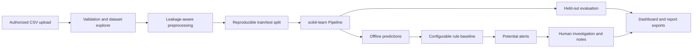
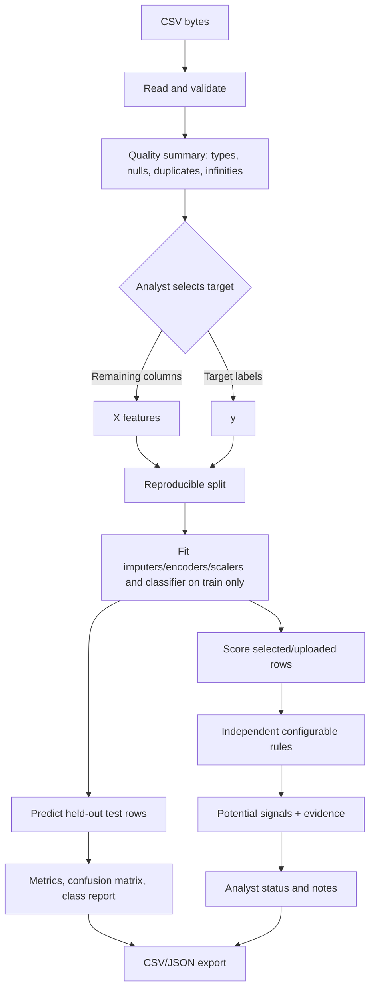

# AI-Based Network Intrusion Detection System

A local, offline-first student project for exploring authorized network-flow CSV datasets, fitting leakage-aware scikit-learn classifiers, inspecting held-out evaluation results, and reviewing potential security alerts. The Streamlit dashboard does **not** capture packets, scan networks, block hosts, or prove that an incident occurred.

> **Dataset status:** No dataset was provided with this project specification. No real-data training or performance result is included. Upload a public, synthetic, or explicitly authorized dataset through the dashboard. Any synthetic rows used by tests are for software validation only and must not be reported as operational IDS performance.

## Abstract and problem statement

Network intrusion detection is difficult because traffic data can be high-volume, noisy, imbalanced, and dependent on collection context. This project offers a modular workflow to inspect labeled flow/event tables and test supervised models while keeping preprocessing fitted on the training partition. Rules are explicit, independently configured signals. Predictions, scores, and rule matches are surfaced for human review, not treated as confirmed attacks.

## Objectives

- Accept and validate CSV-based network-flow or security-event tables without assuming a particular dataset schema.
- Report schema, missingness, duplicates, infinite values, class balance, and preprocessing choices.
- Exclude the selected target from model inputs and keep fitted transformations inside a train-only pipeline.
- Train and evaluate reproducible classifiers on a held-out split.
- Present model predictions separately from transparent threshold rules, with analyst review and export workflows.
- Keep the default workflow offline and avoid active network actions.

## Existing and proposed system

A manual or static demonstration cannot reproduce data checks, provide measured held-out metrics, or support analyst triage. This project proposes an interactive local dashboard connected to reusable Python modules for ingestion, preprocessing, rules, training, evaluation, predictions, alerts, and reporting. Its results remain dependent on the uploaded dataset, labeling quality, sampling, and deployment context.

## Architecture



## Data-flow diagram



## Modules

- `app.py`: Streamlit pages for overview, dataset exploration, preprocessing, training, evaluation, detection, alert investigation, reports, and responsible-use notes.
- `src/data_loader.py`: CSV/dataframe validation and dataset information.
- `src/preprocessing.py`: label/feature separation, split handling, and train-only preprocessing construction.
- `src/rules.py`: configurable, transparent threshold checks independent from ML predictions.
- `src/train_model.py`: model fitting and reproducible training workflow.
- `src/predict.py`: prediction and signal generation helpers.
- `src/evaluation.py`: metrics, classification report, and diagnostics from actual predictions.
- `src/explainability.py`: feature evidence helpers and explanations with appropriate caveats.
- `src/alerts.py`: potential-alert records and investigation status/history helpers.
- `src/reporting.py`: serializable analysis summaries and CSV/report exports.
- `tests/`: fast tests on small in-memory fixtures. These are not network-security performance benchmarks.

## Supported data and dataset licensing

The project accepts a CSV table with one observation per row and a mix of numerical and categorical input fields. For supervised classification, select a target column with at least two classes. The code does not assume CICIDS2017 or any one canonical set of columns. Inspect the source, data dictionary, label conventions, license, and terms of use independently before upload or redistribution.

No dataset is bundled. Obtain a dataset only from its official publisher or another trusted source and comply with its license and privacy restrictions. Do not upload private traffic unless you are explicitly authorized and the environment is approved for the data. Uploaded data is not treated as application instructions or executed.

### Recommended public dataset to start with

The official **UNSW-NB15** page is a suitable starting point for an academic flow-classification project. Use its “HERE” source-files link and select the provided CSV training/testing files or CSV sources. The publisher describes a preconfigured training file with 175,341 rows and a testing file with 82,332 rows; inspect the actual downloaded file, target labels, columns, and size before use rather than assuming a schema [1]. The page grants free use for academic research and says commercial use requires agreement with the authors; it also asks users to cite the listed publications [1]. This repository has not downloaded or bundled the dataset.

As an alternative, the Canadian Institute for Cybersecurity’s **CICIDS2017** page describes labeled flow CSVs and links to machine-learning CSV downloads. Use the official download button on that page, follow its citation instruction, and inspect each extracted CSV independently because derived copies may have different columns and label encodings [2]. The Institute’s dataset guidance says use or redistribution should include a citation to the dataset and associated paper [3]. The dashboard upload is capped at 200 MB; for larger files, use an authorized local sampling or file-splitting workflow and document that selection. Do not treat a sampled subset as the full benchmark.

## Software and hardware requirements

- Python 3.10–3.12 (tested target: Python 3.12)
- pip and a virtual environment
- 4 GB RAM is a reasonable starting point for small/medium tabular datasets; large flow exports may require more memory and sampling
- Modern browser for the Streamlit interface

Exact Python package minimums are listed in `requirements.txt`. There are no external model APIs, credentials, or online services required.

## Installation

```bash
cd AI-Based-Network-Intrusion-Detection
python -m venv .venv
# Linux/macOS
source .venv/bin/activate
# Windows PowerShell: .venv\Scripts\Activate.ps1
python -m pip install --upgrade pip
pip install -r requirements.txt
```

## Launch the application

```bash
streamlit run app.py
```

Streamlit prints a local URL (usually `http://localhost:8501`). Upload a CSV in the sidebar, inspect the schema, select the target label, review data quality, then train a model. The model and investigation notes are held in the active Streamlit session; do not assume persistence after a session ends. No live network capture is performed.


## Model training and evaluation workflow

1. Upload only a supported, authorized CSV.
2. Inspect columns, missing values, duplicates, possible identifiers/time fields, and label distribution.
3. Select the target label. Target labels must not be included as features; also remove any other label-derived or post-event columns that could leak outcome information.
4. Fit a selected classifier with a fixed seed and held-out split. Stratification is used when feasible; exact duplicate feature rows are grouped so copies do not cross train/test partitions. Numeric imputation/scaling and categorical imputation/encoding are fitted within the training pipeline.
5. Review accuracy, precision, recall, F1, false-positive rate when applicable, confusion matrix, per-class report, ROC-AUC/PR analysis when mathematically appropriate, and class imbalance.
   For binary metrics, the positive class is selectable in the dashboard and is recorded in the training configuration; false-positive rate and ROC/PR interpretation are relative to that selected class.
6. Consider the costs of missed detections (false negatives) versus analyst workload from false positives. Select thresholds only using validation data when performing tuning; do not tune on the final test set.
7. Run offline predictions and inspect potential alert evidence. Raw model scores are not labeled calibrated probabilities unless calibration has been fitted and evaluated.

Random Forest, Logistic Regression, and Decision Tree are the primary supervised choices. Isolation Forest may be used for a separate anomaly-detection workflow where the dataset and evaluation protocol support it; it is not equivalent to supervised attack-category classification. Previously unseen attacks may be missed or assigned to a known class: these models do not guarantee zero-day detection.

## Rules, alerts, and investigation

Rules are configurable signals, not universal network thresholds. Their meaning depends on feature units, dataset provenance, collection point, and environment. Each rule finding should explain its configured condition. Rule alerts remain distinct from model outputs. Severity is an analyst triage aid, not proof. The system never blocks devices or modifies network configuration. Investigation states and notes are not durable unless an explicit persistent store is configured.

## Testing

```bash
pytest -q
python scripts/smoke_test.py
```

Tests use small synthetic in-memory tables to verify software behavior. `scripts/smoke_test.py` also runs a small generated synthetic dataset through training, prediction, rule evaluation, alert construction, and temporary CSV/JSON exports. It prints a synthetic demonstration score solely as a software smoke check, deletes its temporary output, and is not real network telemetry or an IDS performance benchmark. To manually smoke-test the user interface, launch Streamlit and upload a small labeled CSV. No real-dataset benchmark scores are claimed in this repository.

## Limitations and future enhancements

- Dataset-dependent behavior; no bundled or pre-downloaded real dataset.
- No packet capture, live monitoring, active scanning, auto-blocking, or remediation.
- A random train/test split can overestimate generalization where flows from the same host/session or time window leak across partitions. Group- or time-aware splits should be used where the dataset requires them.
- High-cardinality identifiers and target-derived fields can cause leakage; analyst review is required.
- Imbalanced classes, label noise, concept drift, unseen attacks, and domain shift affect results.
- Model scores are not calibrated probabilities by default; multiclass ROC-AUC and PR curves require suitable class support.
- The default dashboard is session-scoped; production-grade authentication, durable audit logs, role-based access, and secure storage are not implemented.
- Future work could add dataset-specific group/time splits, carefully evaluated calibration and threshold selection, durable encrypted investigation storage, model monitoring, and a reviewed anomaly-detection workflow.

## Responsible use and privacy

Use only public, synthetic, or explicitly authorized data. Review privacy, retention, and licensing requirements. Do not expose personal data unnecessarily in exports. Predictions are AI-generated potential signals, require qualified human review, and must not be the sole basis for high-impact security decisions. This is an educational prototype, not a certified security product.

## References

[1]: https://research.unsw.edu.au/projects/unsw-nb15-dataset "UNSW-NB15 official dataset page"
[2]: https://www.unb.ca/cic/datasets/ids-2017.html "CICIDS2017 official dataset page"
[3]: https://www.unb.ca/cic/datasets/ "Canadian Institute for Cybersecurity dataset guidance"
